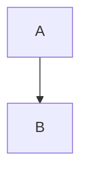

# Brief: inline images in editxr (bead herdr-d1f)

You are working in `/Users/svallory/worktrees/editxr/hyperlab-images` (git worktree of the **hyperlab-sh/editxr** fork, branch `hyperlab-images`, based on `hyperlab`). editxr is a Swift terminal markdown editor that renders markdown in place (no separate preview). Read `README.md`, `Sources/editxr/App/EditorApp.swift` (`render()`, `renderNormalMode`, `renderNormalModeWrapped`, `renderSegment`, the `.codeBlock` kind, `state.scrollOffset`), `Sources/editxr/Services/Mirror.swift` (an example of a small fork-only feature) and `Sources/editxr/Services/AIFeature.swift` (how we gate fork features) first.

## Goal

When a document contains a mermaid fence or a markdown image, show the rendered picture inline in the editor using the **Kitty graphics protocol**, in the position where the block is, instead of (or on top of) the raw text:

````markdown



````

Rules:

- Rendering is **off** when the cursor is inside the fence/image line (the user is editing it) and in any view where the raw text is shown (diff view, etc.). Then the block renders exactly as today.
- Mermaid fences are rasterised by an external helper: `mini-md-ide mermaid-png --theme dark|light --scale N` reading mermaid on stdin and writing PNG on stdout, exit 2 = unsupported diagram (fall back to the raw fence silently), exit 1 = error (fall back, show a one-line status message). The helper binary comes from `$EDITXR_MERMAID_PNG` (full path) or `mini-md-ide` on PATH. **It does not exist yet** — it is being built in parallel. For development use the stub at `agent/stub-mermaid-png.sh` (returns a fixed PNG from `agent/fixtures/`); its contract is the same.
- Cache PNGs by SHA-256 of (theme, scale, fence source) under `$XDG_CACHE_HOME/editxr/mermaid/` (default `~/.cache/editxr/mermaid/`). Render asynchronously (a DispatchQueue), show the raw fence until the PNG arrives, then redraw.
- `` images: relative to the document's directory; PNG only for the first version (decode nothing yourself: Kitty transmits PNG as `f=100`). Skip http(s) URLs.
- Image height in cells: `min(configurable max, rows that fit)`; width scaled to keep aspect using the cell size from `TIOCGWINSZ` (`ws_xpixel/ws_ypixel`; if 0, assume 8×16). The block occupies N lines in the rendered layout, so the editor's line→row mapping, scrolling and cursor movement must account for the extra rows. This is the hard part — find the place where the layout decides visual line counts (wrapped mode) and make the image block contribute its height there.
- Must survive redraw/scroll/resize: delete placements (`a=d`) before a full redraw, re-emit only the visible ones; transmit each image once (`i=<id>` with `a=t` then `a=p` placements, or `a=T` when simpler) and reuse by id. Images partly scrolled off-screen: clip by not placing (simplest) — note it as an open issue if you can't do better.
- Detection: `$TERM_PROGRAM`/`$KITTY_WINDOW_ID`/`$WEZTERM_EXECUTABLE`/`$GHOSTTY_RESOURCES_DIR` or a Kitty query (`\e_Gi=31,s=1,v=1,a=q,t=d,f=24;AAAA\e\\` and wait ≤100 ms for the reply). No support → everything behaves as today. Also a `--no-images` flag and `images = false` in the config.
- Feature gate like `AIFeature`: `enum InlineImages { static var enabled: Bool }`.

Keep the change rebase-friendly: new code in `Sources/editxr/Services/Images.swift` (+ `KittyGraphics.swift`), minimal hooks in `EditorApp.swift`. Match the surrounding style.

## Constraints

- Do NOT commit, push, or run git commands that change state. Leave the work in the working tree.
- Do NOT touch the LLM/OAuth code or `AIFeature`.
- Use the Write tool / editor for files, not shell heredocs.
- Build on this Mac: `DEVELOPER_DIR=/Library/Developer/CommandLineTools swift build -c release`.
- Tests: XCTest does not run on this Mac. Run them in Docker on forge from this directory: `RCI_HOST=forge rci 'docker run --rm -v "$PWD":/src -w /src swift:6.3.2 swift test --filter Images 2>&1 | tail -30'` (rci mirrors this cwd). One pre-existing failure, `LinkWrapTests.testPanelSplicedOverLinkIsNotInsideHyperlink`, is known on Linux; ignore it. Keep the new code compiling on Linux (`#if canImport(Darwin)` guards where needed, Foundation only — no AppKit/CoreGraphics).
- Verify visually with a PTY: `python3 /Users/svallory/worktrees/editxr/hyperlab-images/agent/ptyprobe.py OUT '[[0.5,""]]' env TERM=xterm-kitty EDITXR_MERMAID_PNG=agent/stub-mermaid-png.sh .build/release/editxr agent/fixtures/sample.md` then grep OUT for `\x1b_G` escapes; assert the placement row matches the block's row. Also run it in WezTerm yourself if you can (`$WEZTERM_EXECUTABLE`).
- Max 3 attempts on any one obstacle; then stop and write `STATUS: BLOCKED` with evidence in the report.

## Deliverables

1. The feature, compiling on macOS (release build in `.build/release/editxr`) and Linux.
2. `agent/fixtures/sample.md` (a doc with a mermaid fence, a PNG image, text around them) and `agent/fixtures/sample.png`.
3. Tests (`Tests/editxrTests/ImagesTests.swift`): fence detection + cache key stability, Kitty escape encoding (chunking at 4096 bytes, `m=1/0`), layout height contribution with images on/off, cursor-inside-fence disables rendering. Also run `RenderTests` and `CursorScrollTests` since you touch layout.
4. `README.md`: short "Inline images (hyperlab fork)" section.
5. Report at `agent/reports/2026-10-20-inline-images.md`: design (where the layout hook is, how placements are tracked), what works in WezTerm, what was verified by PTY, test command + counts ("affected tests pass (N)" — never "all tests pass"), binary size delta, open issues, honest assessment of scroll behaviour.
6. When finished, create the empty file `agent/DONE` (last action).
